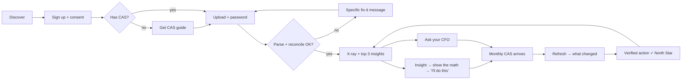

# 09 · User Journeys

**Status:** v0.1 · **Last updated:** 2026-10-03
Personas (PRD §7):
- **Rohan**: primary. A time-poor engaged investor: wants to be involved in his money but has no time to research.
- **Priya**: secondary. The family proxy for her father, a distributor-led investor in regular plans bought through a bank.
- Full personas, plus the parked first-time saver (Ramesh): [11-segments-personas.md](11-segments-personas.md).

The **Persona** column says who goes through each journey. Where it's "Rohan + Priya", the steps are the same and only the emphasis differs: Rohan cares most about returns vs his funds and overlap; Priya cares most about the cost of regular plans and seeing several family members in one place. Journeys only one of them takes are marked with that name.
Problem codes P1–P6 refer to 08-problem-validation.md. Feature codes F1–F14 refer to the PRD.

## 1. The core loop

## 2. All journeys at a glance
| ID | Journey | Persona | Trigger | Outcome | Phase / priority | Features |
|---|---|---|---|---|---|---|
| J0 | Discover and decide to try | Rohan + Priya | Friend link, LinkedIn/Reddit post, shared report card | Lands, trusts enough to sign up | P1 · Must | Landing |
| J1 | Sign up, consent, AI disclosure | Rohan + Priya | "Check my portfolio" | Account + purpose consents recorded | P1 · Must | F1 |
| J2 | Get my CAS (doesn't have one) | Rohan + Priya | No statement at hand | Detailed CAS in inbox | P1 · Must | F2 guide |
| J3 | Upload and parse (incl. every failure path) | Rohan + Priya | Has the PDF | Reconciled portfolio, or a precise fix | P1 · Must | F2, F3 |
| J4 | First x-ray: the "aha" | Rohan + Priya | Parse succeeded | Sees top 3 insights in < 3 min | P1 · Must | F4, F5 |
| J5 | Insight deep dive | Rohan + Priya | Taps an insight | Understands, checks the math, marks intent | P1 · Must | F5 |
| J6 | Ask your CFO (chat), incl. the advice-seeking path | Rohan + Priya | Has a question | Grounded answer or compliant redirect | P1 · Must | F6, F7 |
| J7 | Monthly refresh → what changed → verified action | Rohan + Priya | Monthly CAS email / reminder | Diff seen; action confirmed | P1 · Should | F9 |
| J8 | Family view: add a parent's portfolio | Priya | Manages parents' money | Combined + per-member view | P1 · Should | F10 |
| J9 | Risk questionnaire: stated vs actual | Rohan + Priya | Prompt after first x-ray | Sees gap between stated and actual equity share | P1 · Should | F11 |
| J10 | Behaviour moment: market falls | Rohan | Index down sharply / SIP about to be cancelled | Sees own history and the cost of stopping, as education, not advice | P1 · Should (P2 evidence) | F5, F6 |
| J11 | Report a wrong number / rate an answer | Rohan + Priya | Something looks off | Flag logged and fixed within SLA | P1 · Must | F7 |
| J12 | Share a report card | Rohan + Priya | Proud or alarmed | Anonymised image shared | P1 · Could | F14 |
| J13 | Join Account Aggregator waitlist | Rohan + Priya | Dislikes uploading PDFs | On waitlist (demand signal) | P1 · Should | F12 |
| J14 | Data controls: delete statement, export, withdraw consent, delete account | Rohan + Priya | Privacy concern / leaving | Hard delete confirmed | P1 · Must | F8 |
| J15 | Return visit with stale data | Rohan + Priya | Opens app after weeks | Prompted to refresh; sees what may have changed | P1 · Should | F9 |
| J19 | Advice (internal mode): review and approve recommendations for a family member | Founder | New CAS uploaded for an allow-listed member | Reviewed recommendations shown with net ₹ benefit after tax | P1 · Must (internal) | F15 |
| J20 | Advice demo: explore a sample persona's recommendations | Recruiter / interviewer | Opens demo link | Understands the engine end to end in < 5 min | P1 · Must (demo) | F16 |
| J16 | Connect bank/card statements → spend and surplus | Rohan + Priya | Wants "how much can I invest?" | Investable surplus estimate | **P2** | — |
| J17 | Set a goal → plan → personalised advice | Rohan + Priya | Life event (house, child) | Advice under RIA, after suitability | **P3 (RIA)** | — |
| J18 | Tax: capital-gains report → harvesting suggestions | Rohan + Priya | Jan–Mar tax season | ITR-ready gains report; advice under RIA | **P4** (report pre-RIA) | — |

## 3. Detailed maps (the journeys that make or break Phase 1)

### J2 · Get my CAS — *the biggest drop-off risk*
| Step | User does / thinks | Risk | Design response | Metric |
|---|---|---|---|---|
| 1 | "What's a CAS? Where do I get it?" | Abandons | 3-option chooser: **"Check your inbox first"** (monthly NSDL/CDSL CAS) · MF Central (one PDF, both RTAs) · CAMS + KFintech | Guide → request rate |
| 2 | Requests a *detailed* CAS, since inception, sets password | Picks Summary; short date range | Annotated screenshots; "choose **Detailed**", "from first investment" | Summary-CAS error rate |
| 3 | Waits for email | Email goes to an old KYC address | "Didn't arrive in 10 min?" → explain the KYC email rule | Time to CAS |
| 4 | Returns with PDF (often on phone, from Gmail) | Can't find the file on phone | Mobile: "Share to Personal CFO" (Android) / "Files" picker; desktop: drag-drop | Return rate within 24 h |

### J3 · Upload and parse
| Path | What the user sees |
|---|---|
| ✅ Success | "Read 9 funds, 412 transactions. Totals match your statement ✓" → x-ray |
| 🔑 Wrong password | "That password didn't open it. CAMS/KFintech: the one you set. NSDL/CDSL: usually your PAN in capitals" (⚠ verify the current depository password format on real files in S0) |
| 📄 Summary CAS | "This is a *summary* statement. We need *detailed* for your real returns. Here's how (30 s)." Offer: show holdings-only x-ray now, returns later |
| 🧾 NSDL/CDSL monthly CAS on first upload | Accept for holdings; ask for one detailed RTA CAS to unlock lifetime XIRR |
| ⚠️ Totals don't reconcile | No data shown. "We couldn't match your statement's total, so we won't show numbers we're not sure of. We've logged it; fixed within 48 h." |
| ❌ Not a CAS / corrupt / > 10 MB | Specific message + guide link |
**Principle:** never show a number that failed reconciliation (D-009).

### J4 · First x-ray: the "aha" in < 3 minutes
1. **Headline in one line:** "₹X across N funds. Your money earned Y% a year; your funds earned Z%." The investor vs fund return gap is P2, the strongest evidence-backed insight.
2. **Top 3 insights** ranked by ₹ impact: e.g., "4 of your funds share 60% of their stocks" (P6), "₹X/yr in expense ratios" (P5), "Your stated risk is moderate; 92% is in equity" (J9).
3. Each has "Show the math" and "Ask about this".
4. **No recommendation verbs** anywhere ("consider", "you should" are banned in Phase 1 copy; the advice-boundary test enforces this).

### J6 · Ask your CFO: four branches
| Intent | Example | Response pattern |
|---|---|---|
| Explain a fact | "Why is my return lower than the fund's?" | Grounded explanation with cited facts |
| Education | "What's an expense ratio?" | KB-grounded answer with a source link |
| **Advice-seeking** | "Should I sell Fund B?" | The relevant facts (overlap, cost, lag) + the questions to weigh + "a personal recommendation needs a SEBI-registered adviser". No verdict |
| Missing data / out of scope | "What will Nifty do?" / "What's my FD rate?" | "I don't have that" + what we *can* show |

### J7 · Monthly refresh → verified action (North Star)
1. Monthly NSDL/CDSL CAS lands in the inbox, or a reminder fires around the 12th of the month (statements arrive by the 10th; AMFI).
2. User uploads or shares it → diff: "Since last month: +1 fund, SIP in Fund C stopped, exited Fund B."
3. Matching an earlier insight → "Did our overlap insight prompt this?" → confirmed = **Verified Action**.
4. If nothing changed: show progress on open insights, with no nagging. One reminder max per month.

### J8 · Family view (Priya)
Add member → name label (no PAN typed; it's read from the CAS and stored hashed) → **consent attestation** ("I have my mother's permission") → upload → per-member and combined x-ray. The regular-plan cost insight (P5) is the hero here. ⚠ OI-4: legal review of uploading on someone else's behalf.

### J10 · Behaviour moment (market fall)
Trigger: Nifty falls sharply, or the user opens the app after a long gap. Show the user's *own* history: "Your SIPs since 2021: N months, including the 2022 fall. Your SIP return vs your lumpsum return." Plus education on rupee-cost averaging. **No "don't stop your SIP"** instruction: that's a recommendation. ⚠ L-1 to confirm the wording line.

## 4. Journey → metric map
| Journey | Leading metric | Linked guardrail |
|---|---|---|
| J2 | Guide → CAS obtained within 24 h | — |
| J3 | Parse success; summary-CAS rate | Reconciliation-failure display = 0 |
| J4 | Time to first insight (p50) | Advice-verb copy test |
| J5 | Show-the-math open rate; "I'll do this" rate | Numeric fidelity 100% |
| J6 | Questions per user; 👍 rate | Advice violations 0; cross-tenant leaks 0 |
| J7 | 30-day re-upload; verified actions (NSM) | ≤ 1 reminder / month |
| J14 | Deletion SLA met | 100% |

## 5. Open questions for interviews
- J2: do they already have the monthly CAS in their inbox, and do they know it?
- J3 / J7: phone or laptop when handling the PDF? (feeds 10-platform-decision)
- J6: what would they ask first?
- J10: would they want a message during a market fall, or find it patronising?
